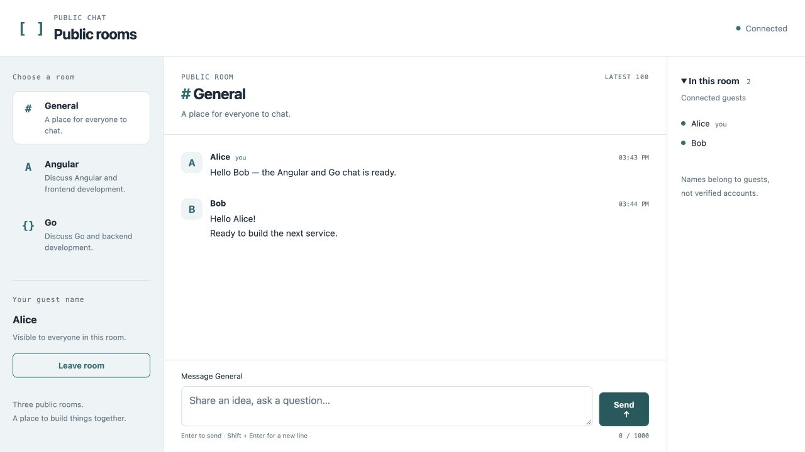
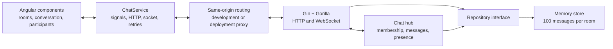

# Angular + Go Chat

A real-time public-room chat application built with **Angular 21**, **Go**, **Gin**, and **Godog**. A learning project for WebSockets, behavior-driven development, and the boundaries that let a small service grow into a larger system.

Choose a guest name, join **General**, **Angular**, or **Go**, and chat with everyone in that room. Recent messages, connected guests, and connection status update as the conversation happens.



## What it does

- Exchanges messages immediately between browser tabs using WebSockets.
- Keeps messages and presence isolated by room.
- Sends history and current participants when a guest joins.
- Retains the latest 100 messages per room while Go is running.
- Reconnects automatically and preserves drafts during disconnection.
- Supports Enter to send, Shift+Enter for newlines, and input-method composition.
- Renders plain text safely, formats timestamps in the browser's locale, and preserves your position when reading older messages.
- Fits desktop and mobile screens, including reduced-height layouts.

This version uses anonymous guest names and one chat service. Persistence, verified accounts, private rooms, and distributed delivery are future additions.

## Stack

| Layer          | Technology                                             | Responsibility                                               |
| -------------- | ------------------------------------------------------ | ------------------------------------------------------------ |
| Browser        | Angular 21, TypeScript, standalone components, signals | UI, connection state, and drafts                             |
| API            | Go, Gin 1.12, Gorilla WebSocket 1.5.3                  | Routes, upgrades, validation, and socket lifecycle           |
| Domain         | Go packages and a repository interface                 | Rooms, membership, publication, and history                  |
| Storage        | Bounded memory store                                   | Latest 100 messages per room                                 |
| Behavior tests | Godog 0.16                                             | User scenarios through real HTTP and WebSocket clients       |
| Frontend tests | Vitest through Angular CLI                             | Service state, retries, rendering, and keyboard interactions |
| Rendering      | Angular SSR and prerendering                           | Initial screen; live chat starts in the browser              |

The Angular SSR host uses Node.js to render the application shell. Go owns the chat behavior and transport.

## Run it locally

Use **Node.js 24**, **npm 11**, and **Go 1.27.2** or a later toolchain compatible with `go.mod`.

```sh
git clone https://github.com/Eloe321/angular-go-chat.git
cd angular-go-chat
npm ci
go mod download
```

Start Go in one terminal:

```sh
npm run start:api
```

Start Angular in another terminal, from the same repository:

```sh
npm start
```

Open [localhost:4200](http://localhost:4200) in two tabs. Join General as Alice and Bob, then send a message. Both tabs receive it. Switch one guest to Angular to see room isolation, then return to General to see its history.

The API listens on `127.0.0.1:8080`. Angular's development proxy forwards `/api/**` and `/ws` to Go, so the browser uses one origin for HTTP and WebSocket traffic.

```sh
curl http://127.0.0.1:8080/healthz
# {"status":"ok"}
```

Use a checkout path without a colon (`:`). The installed Vite development server rejects filesystem paths containing colons. See [How to develop and verify the chat](docs/how-to-develop.md) for configuration and troubleshooting.

## Architecture and logic



1. **Discover rooms.** After the browser renders, Angular requests `/api/rooms`. Server rendering never opens a chat socket.
2. **Join a room.** Go validates the name, room, and browser origin before upgrading to a WebSocket.
3. **Receive one initial snapshot.** The hub registers the guest and queues `session.ready` first, with the session ID, room, recent messages, and participants.
4. **Publish a message.** The client sends a command type and content. Go validates the text, creates the ID, sender metadata, and UTC timestamp, stores the message, and broadcasts it to that room, including the sender.
5. **Recover from interruption.** Angular retries after 1, 2, 4, 8, and then 15 seconds. A ready snapshot replaces stale history. Leaving or switching rooms cancels the previous socket and retries.

Read [Architecture and design decisions](docs/architecture.md) for the full sequence and trade-offs, or the [HTTP and WebSocket reference](docs/protocol.md) for exact JSON shapes.

## Interesting decisions to highlight

| Decision                                | Why it matters                                                                                                             | Implementation                                                   |
| --------------------------------------- | -------------------------------------------------------------------------------------------------------------------------- | ---------------------------------------------------------------- |
| Atomic history and live delivery        | A guest joining during publication receives that message in either the snapshot or live queue, without a gap between them. | [Hub concurrency tests](internal/chat/hub_test.go)               |
| Server-owned message identity           | Clients cannot choose another session's sender ID, message ID, or timestamp. Guest names remain unverified.                | [Message publication](internal/chat/hub.go)                      |
| Bounded queues for slow guests          | Each client has 64 outbound event slots. A full queue disconnects that guest instead of blocking other members.            | [Hub](internal/chat/hub.go)                                      |
| Ready means registered                  | An open transport alone does not enable sending. The client waits for `session.ready`.                                     | [Connection service](src/app/chat/chat.service.ts)               |
| Explicit reconnect behavior             | Old socket callbacks are ignored, drafts survive disconnects, and uncertain messages are never automatically resent.       | [Connection tests](src/app/chat/chat.service.spec.ts)            |
| Shutdown covers pending handshakes      | Connections are tracked during the upgrade as well as during chat. A stalled handshake cannot hold the lifecycle lock.     | [Handshake regressions](internal/transport/handshake_test.go)    |
| Storage is replaceable                  | Chat rules depend on `History` and `Append`, allowing a database implementation behind the same interface.                 | [Repository interface](internal/chat/store.go)                   |
| Behavior tests use the actual transport | Godog connects real clients to an isolated server and exercises the public protocol.                                       | [Scenarios](features/chat.feature) and [steps](bdd/chat_test.go) |

## How it was built

| Stage                               | Work and outcome                                                                                                                    |
| ----------------------------------- | ----------------------------------------------------------------------------------------------------------------------------------- |
| Define the MVP                      | Fixed three public rooms, guest identities, bounded history, and an explicit JSON protocol.                                         |
| Describe behavior first             | Wrote failing Godog scenarios for discovery, messaging, isolation, validation, presence, and reconnect history.                     |
| Implement Go boundaries             | Built the memory repository, serialized hub, Gin routes, and reader/writer lifecycle. Added focused concurrency and boundary tests. |
| Build Angular state and UI          | Added typed models, browser-only initialization, signals, controlled retry tests, and the responsive screen.                        |
| Review and exercise the application | Checked two-browser messaging and mobile layouts. Fixed handshake shutdown, locale formatting, and history/composer regressions.    |
| Verify the result                   | Ran Go race tests, `go vet`, Angular tests, and the browser/SSR/prerender build.                                                    |

The original [design](docs/superpowers/specs/2026-10-14-chat-mvp-design.md) and [implementation record](docs/superpowers/plans/2026-10-14-chat-mvp.md) preserve the agreed scope and completed work.

## Godog development workflow

Godog turns Gherkin scenarios into executable acceptance tests. This example uses the project's existing step definitions:

```gherkin
Scenario: Guests exchange a message
  Given an isolated chat service
  And "Alice" connects to "general" as "alice"
  And "Bob" connects to "general" as "bob"
  When "alice" sends "Hello, Bob"
  Then "bob" receives "Hello, Bob" from "Alice"
```

Add a scenario to `features/chat.feature`, run it to establish the expected failure, implement the smallest change that satisfies it, and refactor while it remains green. Each scenario owns its service, memory store, connections, and cleanup.

```sh
npm run test:bdd
npm run test:api
```

[How to develop and verify the chat](docs/how-to-develop.md) explains step definitions, focused tests, and configuration changes.

## Verification

```sh
npm test -- --watch=false
npm run build
go test -race ./...
go vet ./...
```

| Check                                   | Verified result                                                                                     |
| --------------------------------------- | --------------------------------------------------------------------------------------------------- |
| Angular service and screen tests        | 32 passing tests                                                                                    |
| Godog behavior suite                    | 12 scenarios and 56 steps passing                                                                   |
| Go domain, transport, and process tests | Passing with the race detector                                                                      |
| Go static checks                        | `go vet ./...` passes                                                                               |
| Production build                        | Browser and SSR bundles; initial route prerenders                                                   |
| Chromium browser QA                     | Two guests, room isolation, history, multiline input, reconnects, drafts, and older-history reading |
| Responsive QA                           | 390×844, 320×700, 390×500, and 390×601, including reconnect feedback and reachable controls         |

Browser QA covers the implemented MVP. A browser matrix, load tests, and a full security audit are separate future checks.

## Growing it into services

The backend is one independently runnable chat service. Its boundaries provide places to add the next capabilities:

1. **Persist history.** Implement PostgreSQL behind the repository interface, then add migrations and database tests.
2. **Verify identity.** Add an identity service and authenticated room/message authorization. Replace anonymous handshake identity with verified credentials.
3. **Deliver durable events.** Define event IDs, retries, and idempotency. Add durable publication before other services rely on accepted-message events.
4. **Add notifications.** Consume message events in a notification service with delivery retries and user preferences.
5. **Run multiple chat instances.** Share live events through a broker and define missed-event recovery. Independent memory hubs cannot provide one shared room across instances.

Every room is public, duplicate names are allowed, and restarting Go clears all history. Deployment needs HTTPS/WSS and a reverse proxy routing `/api` and `/ws` to Go; the development proxy is local tooling.

## Project map

```text
cmd/chat/                 Configuration, HTTP startup, and shutdown
internal/chat/            Domain models, validation, hub, repository
internal/transport/       Gin endpoints and WebSocket lifecycle
features/chat.feature     Executable behavior descriptions
bdd/chat_test.go          Steps using real HTTP/WebSocket clients
src/app/chat/             Connection service and conversation component
src/app/app.*             Guest entry, room navigation, participants
proxy.conf.json           Local HTTP and WebSocket forwarding
docs/                     Guides, architecture, protocol, design, previews
```

## Documentation

- [Try the chat in two tabs](docs/tutorial-chat.md)
- [How to develop and verify the chat](docs/how-to-develop.md)
- [Architecture and design decisions](docs/architecture.md)
- [HTTP and WebSocket reference](docs/protocol.md)

## References

The supplied tutorials inspired the WebSocket and BDD approach. The implementation uses the installed Angular version, Go modules, and Godog's `go test` integration.

- [Archived Angular and Go WebSocket tutorial](https://web.archive.org/web/20260214230813/https://www.thepolyglotdeveloper.com/2016/12/create-real-time-chat-app-golang-angular-2-websockets/)
- [Building Go applications and microservices with Gin](https://semaphore.io/community/tutorials/building-go-web-applications-and-microservices-using-gin)
- [Godog behavior-driven development tutorial](https://semaphore.io/community/tutorials/how-to-use-godog-for-behavior-driven-development-in-go)
- [Gin documentation](https://gin-gonic.com/en/docs/)
- [Godog documentation](https://github.com/cucumber/godog)
- [Gorilla WebSocket documentation](https://pkg.go.dev/github.com/gorilla/websocket)
- [Angular development proxy](https://angular.dev/tools/cli/serve#proxying-to-a-backend-server)
