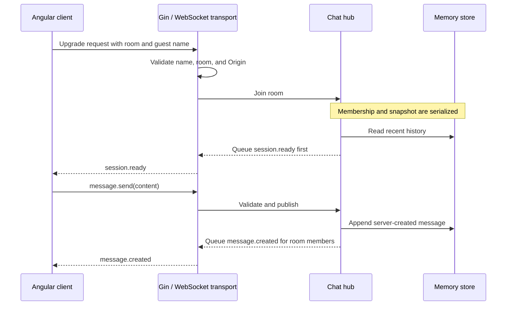

# Architecture and design decisions

A chat application has to coordinate messages already stored with messages being published now. It also has to keep one slow connection from disrupting everyone else. This project makes those rules explicit while keeping the first version small enough to study.

## Boundaries

| Module                | Owns                                                                   | Does not depend on        |
| --------------------- | ---------------------------------------------------------------------- | ------------------------- |
| `cmd/chat`            | Environment configuration, listener, signals, shutdown                 | Angular                   |
| `internal/transport`  | Gin routes, origin checks, upgrade tracking, socket reader/writer      | UI state                  |
| `internal/chat`       | Room catalog, validation, membership, publication, repository contract | Gin and Gorilla WebSocket |
| `MemoryStore`         | Thread-safe copies of the latest history                               | Browser connections       |
| Angular `ChatService` | Room loading, typed events, connection state, retries, teardown        | Go implementation details |
| Angular components    | Guest forms, room navigation, participants, composer, scrolling        | Socket ownership          |

Go owns all chat behavior. Angular's existing Node SSR host renders the initial shell; browser-only initialization loads rooms and opens sockets after rendering.

The repository interface currently has two operations:

```go
type Repository interface {
    History(roomID string) ([]Message, error)
    Append(Message) error
}
```

This provides a place to add persistent storage. A future database implementation also needs migrations, failure handling, and integration tests.

## A message's journey



The writer sends queued events to each socket. Presence updates follow membership changes. The [protocol reference](protocol.md) defines the complete payloads.

## Why one atomic initial snapshot?

Fetching history over HTTP and then opening a socket creates a gap: a message published between those operations could be absent from both views.

The hub holds one mutex across membership registration, the history read, and queueing `session.ready`. Publication uses the same mutex. A racing message therefore lands in either the initial snapshot or the subsequent live queue. The frontend initializes from this event rather than racing a history request against the connection.

**Trade-off:** hub operations serialize across rooms in this version. It favors simple, testable ordering for a single service. Future partitioning or distributed delivery needs an equivalent ordering/recovery contract.

[The concurrency regression](../internal/chat/hub_test.go) races joining against publication and checks that the message is observed once across snapshot and live events.

## Why bounded storage and outbound queues?

An unlimited history would grow for as long as the process runs. The memory store retains only the latest 100 messages per room, returning copies so callers cannot mutate stored history.

Each client also has 64 outbound event slots. Publication performs nonblocking queue sends. If a queue fills, the hub removes that client and announces the new presence. Healthy guests continue receiving messages.

**Trade-offs:** history is not a durable archive, and a lagging guest may be disconnected. After reconnecting, that guest gets the latest bounded snapshot; older messages outside that window are unavailable.

## Why one reader and one writer?

The socket reader decodes commands and forwards them to the domain. The writer alone sends data events and scheduled pings. Read limits, pong deadlines, and write deadlines bound unhealthy connection lifetimes.

The transport counts pending handshakes before upgrades and tracks raw hijacked connections during the handshake. Shutdown can close both pending and established connections. Network I/O happens outside the lifecycle mutex.

**Trade-off:** these rules require explicit worker tracking and cleanup, but make cancellation and shutdown behavior testable. [Handshake tests](../internal/transport/handshake_test.go) reproduce stalled writes and upgrades completing during shutdown.

## Why does the server create identity and timestamps?

A browser supplies its guest label and content. The hub creates session/message IDs, derives sender metadata from the active session, and supplies UTC timestamps. A command cannot impersonate another session by supplying its own `senderId`.

**Trade-off:** names remain unverified and may be duplicated. Session IDs distinguish connections; they do not establish authenticated accounts. A reconnect receives a new identity for that session.

## Why wait for session.ready?

A WebSocket opening only confirms the transport exists. It does not confirm room registration or that the initial data is available.

Angular moves to `connected` only after a valid ready event for the chosen room. Only then can the composer send. Broadcasts are rendered after the server supplies accepted messages, without inventing optimistic message records.

## Why avoid automatic message replay?

If a connection breaks after the browser hands a message to the socket, the client may not know whether Go accepted it. Automatically resending could produce duplicates.

The client preserves an unsent draft during interruption, disables sending until ready, and reconnects with delays of 1, 2, 4, 8, then 15 seconds. A generation counter and socket identity checks reject callbacks from replaced connections. Leaving, switching rooms, or destruction closes sockets and cancels retry timers.

**Trade-off:** delivery during an uncertain disconnect is not guaranteed. The user checks the recovered history and decides whether to send again.

## UI design

The screen has a quiet room rail, a central conversation, and a participant list. Slate text and teal actions establish hierarchy without hiding the content behind decoration.

Labels, visible focus, live connection status, and escaped text are part of the interaction model. Enter sends; Shift+Enter inserts a newline; composition events prevent accidental sends while entering text. Native `Intl.DateTimeFormat` follows the browser's locale while `datetime` preserves the server's UTC value.

New messages scroll into view only when the reader is within 64px of the log's bottom. Mobile layouts keep a bounded message pane with at least 96px of height. Outer scrolling keeps controls reachable when headers, reconnect feedback, or a short viewport consume the available space.

## From one service to several

The current service owns rooms, live sessions, and message history. The next boundaries are:

- **Storage:** replace memory with PostgreSQL and define retention/pagination.
- **Identity:** verify credentials and authorize room entry and message actions.
- **Events:** define durable publication, event IDs, retries, and idempotency.
- **Notifications:** consume accepted-message events with delivery preferences.
- **Multiple chat instances:** use shared event delivery and missed-event recovery.

Starting several copies of the current process would create separate histories and memberships. A broker alone is also insufficient for a durable archive; storage and recovery semantics need to be defined together.

## Related

- [HTTP and WebSocket reference](protocol.md)
- [How to develop and verify the chat](how-to-develop.md)
- [Two-tab tutorial](tutorial-chat.md)
- [Original approved design](superpowers/specs/2026-10-14-chat-mvp-design.md)
- [Project overview](../README.md)
